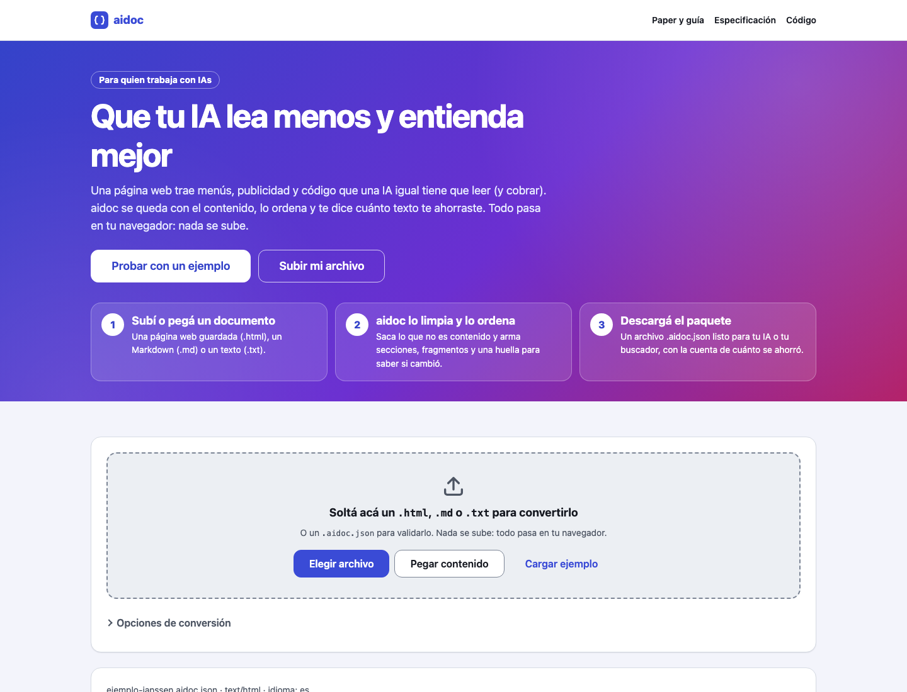

<div align="center">

# aidoc

**Estructura para IAs.** Digerir una vez, usar muchas veces: convierte HTML o Markdown en un paquete `.aidoc.json` pre-digerido para IAs, mide cuántos tokens ahorra y lo valida contra su especificación.

[**▶ Probala en vivo**](https://loiaconobruno.github.io/aidoc/) · [**📄 Paper y guía**](https://loiaconobruno.github.io/aidoc/guia.html) · [Comparativa](#comparativa-con-docling-y-markitdown) · [Cómo funciona](#cómo-funciona) · [Limitaciones](#limitaciones)

[](https://github.com/LoiaconoBruno/aidoc/actions/workflows/tests.yml)


[](LICENSE)



</div>

Conversor y especificación v0.1 de un **paquete "pre-digerido" para IAs**, para la idea "lenguaje de estructuración nativo para IAs". La propuesta: *digerir una vez, usar muchas veces*. Quien produce un documento genera también una versión estructurada para máquinas, y cualquier IA la usa sin repetir el trabajo de extraer todo.

La página convierte HTML, Markdown o texto en un paquete `.aidoc.json` con:

- **texto canónico** en Markdown, sin menús, scripts ni estilos;
- **metadatos**: título, idioma, fuente, tipo original, fecha y huella SHA-256 del original;
- **secciones** con su ruta de títulos y su posición en el texto;
- **fragmentos** listos para búsqueda, cortados entre párrafos, cada uno con su huella SHA-256 y sus tokens estimados;
- **tablas** (encabezados y filas), **enlaces** e **imágenes**, con su descripción y el texto que contienen si las describís con un modelo, y qué modelo lo hizo;
- una **medición**: tokens del original contra los del texto canónico, estimados o contados con el tokenizador real de Claude.

También **valida** un `.aidoc.json` contra [`spec/aidoc-0.1.schema.json`](spec/aidoc-0.1.schema.json) (JSON Schema 2020-12) y revisa que cada fragmento coincida con el texto y con su huella.

## Por qué

Leer un formato es barato; lo caro es **interpretarlo**. El estándar tiene que guardar esa interpretación, no los datos crudos. Este es el conversor de referencia y el borrador de la especificación que la idea pedía como primer paso, con la medición de tokens "crudo contra convertido" y una comparativa contra las dos herramientas más usadas.

## Instalación

No hace falta instalar nada: **[abrila en el navegador](https://loiaconobruno.github.io/aidoc/)**.

Para usarla sin conexión o modificarla:

```bash
git clone https://github.com/LoiaconoBruno/aidoc.git
```

Después abrí `index.html` con doble clic. No hay dependencias ni paso de build. Los tests corren con Node 22, la versión del CI:

```bash
npm test
```

## Uso

Abrí la [demo en vivo](https://loiaconobruno.github.io/aidoc/) o `index.html` con doble clic. Todo se procesa en el navegador.

1. **Soltá un archivo** `.html`, `.md` o `.txt` en la zona de arriba, elegilo o pegá el contenido. Para probar, apretá **Cargar ejemplo**: una página HTML sobre el efecto Janssen con todo el ruido típico de la web (menú, banner, scripts de analítica, estilos y pie).
2. **Mirá la medición:** el ejemplo tiene **493 tokens** en el original y **183** en el texto canónico, **63 %** de ahorro, con la estimación de 1 token cada 4 caracteres. Al lado aparece "✓ Cumple aidoc 0.1": el paquete pasó la validación completa.
3. **Compará** el original y el resultado lado a lado (en el celular, con el selector Original / Resultado). En **Estructura**, tocá una sección para verla marcada en el texto; en **Fragmentos**, lo mismo con cada fragmento.
4. **Descargar el paquete (.aidoc.json)** lo guarda. Si soltás un `.aidoc.json` en la zona de arriba, la página lo valida y lista cada problema con su ruta, por ejemplo `/fragmentos/0/hash: no cumple el patrón`.
5. **Opcional, con tu key de la API de Anthropic** (en el panel "Opcional: conectar con Claude", que se abre con un clic): **Contar con Claude** reemplaza la estimación por el conteo real del modelo elegido, que es gratuito, y en **Imágenes**, **Describir con Claude** completa la descripción y el texto de cada imagen, con costo para tu cuenta. El paquete guarda qué modelo hizo cada cosa.

## Comparativa con Docling y MarkItDown

[`bench/`](bench/) convierte 5 documentos reales con las tres herramientas y mide tokens, tiempo y calidad. Los documentos son: un artículo de Wikipedia en español, una referencia de MDN, un capítulo del tutorial de Python, un RFC en HTML heredado y un README en Markdown. Están guardados en [`bench/docs/`](bench/docs/) con su licencia. Las definiciones de cada medida están en [`bench/README.md`](bench/README.md), y el detalle por documento en [`bench/resultados.md`](bench/resultados.md).

<!-- bench:inicio -->
**Tokens de la salida** (entre paréntesis, respecto del original):

| Documento | Original | aidoc | Docling | MarkItDown |
|---|---:|---:|---:|---:|
| Código QR (Wikipedia en español) | 49.670 | 10.503 (21 %) | 10.472 (21 %) | 14.199 (29 %) |
| MDN: el elemento `<table>` | 69.846 | 13.550 (19 %) | 20.087 (29 %) | 22.209 (32 %) |
| 5. Data Structures (tutorial de Python) | 34.152 | 8.484 (25 %) | 8.833 (26 %) | 9.258 (27 %) |
| RFC 8259: The JSON Data Interchange Format | 10.599 | 8.393 (79 %) | 8.540 (81 %) | 7.133 (67 %) |
| README de MarkItDown (Markdown) | 4.765 | 4.761 (100 %) | 4.692 (98 %) | 4.765 (100 %) |

**Tiempo de conversión**, sin contar el arranque:

| Documento | aidoc | Docling | MarkItDown |
|---|---:|---:|---:|
| Código QR (Wikipedia en español) | 7,8 ms | 121 ms | 45 ms |
| MDN: el elemento `<table>` | 10 ms | 198 ms | 65 ms |
| 5. Data Structures (tutorial de Python) | 7,5 ms | 161 ms | 58 ms |
| RFC 8259: The JSON Data Interchange Format | 3,2 ms | 41 ms | 12 ms |
| README de MarkItDown (Markdown) | 2,3 ms | 100 ms | 4,7 ms |

**Calidad**, sumando los 5 documentos (palabras y ruido: promedio):

| Herramienta | Títulos | Tablas | Enlaces | Palabras del contenido | Ruido que se cuela |
|---|---:|---:|---:|---:|---:|
| aidoc | 80 % | 100 % | 100 % | 100 % | 51 % |
| Docling | 80 % | 100 % | 93 % | 100 % | 78 % |
| MarkItDown | 80 % | 100 % | 95 % | 100 % | 100 % |

Medido el 2026-11-10 en macOS (Darwin 25.5.0), arm64, con aidoc 0.2.0, Docling 2.150.0 y MarkItDown 0.1.9. Tokens con o200k_base (tiktoken); tiempo: mediana de 5 conversiones.
<!-- bench:fin -->

Docling y MarkItDown hacen mucho más que esto: leen PDF, Word, PowerPoint e imágenes, que aidoc no lee. La comparación es solo sobre HTML y Markdown, lo que aidoc sabe convertir.

## Cómo funciona

- **HTML → Markdown** sin DOM, con un tokenizador propio: títulos, párrafos, listas (con anidación), énfasis, código, citas, tablas, imágenes y enlaces. Descarta `script`, `style`, `nav`, `form` y similares. Si la página marca su contenido con `<main>` o `<article>`, usa solo eso ("modo lectura").
- **Secciones:** cada título de Markdown abre una sección que llega hasta el título siguiente. Lo que hay antes del primer título es la sección `(inicio)`.
- **Fragmentos:** se cortan dentro de cada sección, hasta el máximo de caracteres, preferentemente entre párrafos.
- **SHA-256** implementado en JavaScript (sin depender de `crypto.subtle`), verificado contra los vectores de prueba estándar.
- **Validación completa:** un validador propio de JSON Schema 2020-12 (`src/esquema.js`) revisa el paquete contra la especificación, con `date-time` exigido. Pasa los 970 casos del [JSON-Schema-Test-Suite](https://github.com/json-schema-org/JSON-Schema-Test-Suite) oficial que usan las palabras clave que implementa. Después se revisa lo que un esquema no puede expresar: que cada fragmento coincida con su parte del texto y con su huella, y que los rangos y los identificadores sean coherentes.
- **Tokens:** sin key, la estimación de 1 token cada 4 caracteres. Con tu key, el endpoint `count_tokens` de la API de Anthropic, que es gratuito y tiene un límite de pedidos por minuto.
- **Imágenes:** con tu key, Claude Opus 5.5 (o Haiku 5.5, más barato) describe cada imagen y transcribe su texto con salida estructurada. Las imágenes con URL las descarga la API; las de ruta relativa se eligen desde la computadora y se achican a 1568 px de lado antes de mandarlas.
- **Sin servidor:** las llamadas van directo del navegador a `api.anthropic.com`. La key queda en tu navegador, por la sesión o, si lo pedís, de forma permanente.

La interfaz usa el sistema de diseño común del portafolio ([`css/sistema.css`](css/sistema.css)). La lógica está en `src/markdown.js`, `src/aidoc.js`, `src/esquema.js` y `src/claude.js`, sin DOM, y se testea con:

```bash
npm test
```

## Limitaciones

- **No lee PDF ni archivos de Office.** Para eso están Docling y MarkItDown.
- **El conversor de HTML es simple:** las páginas armadas con JavaScript, o con estructuras raras, pueden salir incompletas.
- **El validador no implementa todo JSON Schema 2020-12:** faltan `unevaluatedProperties`, `unevaluatedItems`, `dependentSchemas`, `$anchor`, `$dynamicRef` y las referencias a otros documentos. Si un esquema los usa, avisa en vez de validar a medias. La especificación de aidoc no los usa.
- **El conteo real y la descripción de imágenes no se probaron contra la API real:** los tests usan respuestas simuladas, porque no hay una key en el repositorio. La forma de cada pedido sigue la documentación de la API.
- **Los tokens de los fragmentos siguen siendo estimados**, aun con la key: contarlos uno por uno gastaría el límite de pedidos.
- **La key en el navegador** es cómoda pero no es para producción: cualquiera con acceso a ese navegador puede leerla. Usá una key propia, con límite de gasto.
- **Sin audio ni video**, y sin embeddings, porque los vectores de un modelo no le sirven a otro.

## Próximos pasos

- Probar el conteo y la descripción de imágenes con una key real y ajustar los mensajes de error.
- Medir la calidad de los fragmentos con preguntas y respuestas, no solo con la estructura.
- Escribir la versión 0.2 de la especificación con lo que deje la comparativa.

## Paper de uso y guía

[`guia.html`](https://loiaconobruno.github.io/aidoc/guia.html) (fuente en [`docs/guia.md`](docs/guia.md), generada con `python3 tools/guia.py`) tiene un paper de uso paso a paso y una guía sobre la idea de fondo, con citas a los especialistas del tema.

## Licencia

MIT. Los documentos de `bench/docs/` conservan su propia licencia (ver [`bench/README.md`](bench/README.md)), y `test/json-schema-test-suite/` es MIT del proyecto JSON-Schema-Test-Suite.
